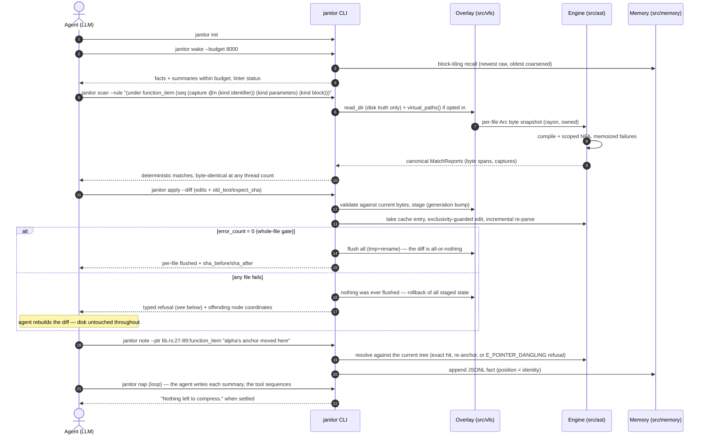
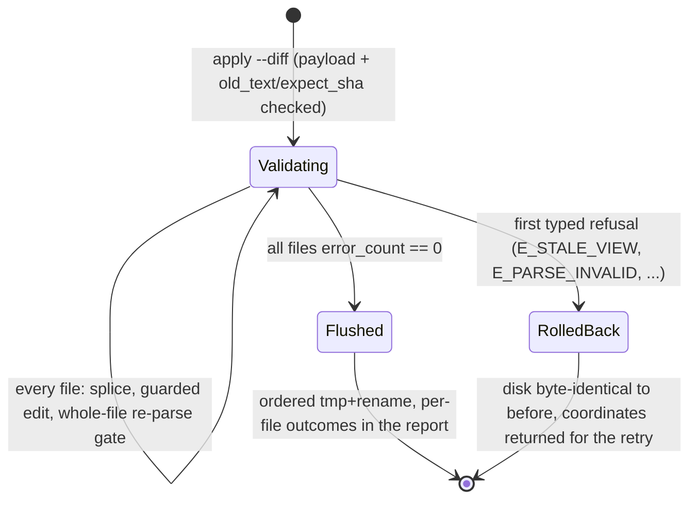

# janitor-prime

**A deterministic refactoring engine, transactional edit layer, and persistent
memory for autonomous coding agents — in one statically-linked Rust binary.**

`janitor` gives an LLM agent three fused capabilities over a target codebase,
with 100% JSON output and zero network calls:

1. **`src/vfs`** — a transactional virtual filesystem: an `Overlay` over `Os`
   that stages edits in memory with a strict anti-phantom invariant
   (`read_dir` never lists staged files) and all-or-nothing commit/rollback
   around multi-file changes.
2. **`src/ast`** — structural search over [tree-sitter] with a small
   s-expression DSL compiled to a scoped NFA: memoized failures make
   catastrophic backtracking structurally impossible, and the match output is
   byte-identical under any rayon thread count.
3. **`src/memory`** — an append-only fact log anchored to real code
   (`SyntaxPointer`: span + kind + content hash), a token-budgeted `wake`
   recall that coarsens the oldest facts first, and `ArchitecturalLock` facts
   that are never compressed. Summaries are written by the consuming agent —
   **no LLM runs inside the binary**.

[tree-sitter]: https://tree-sitter.github.io/

## Status: v0.1.0 + python, go, typescript (F9)

Shipped: `init` · `wake` · `scan` · `apply` · `note` · `nap` — the full agent
loop, end-to-end tested through the real binary. ~180 tests + no-panic fuzz
targets + determinism/determinism-of-output fences in CI; musl/gnu × x86_64/
aarch64 + macOS release matrix.

Languages: **rust**, **python**, **go**, and **typescript** (+ **tsx**) are
fully supported — all CI-tested end-to-end on every PR (`cargo test`,
`cargo test --features lang-python`, `--features lang-go`, and
`--features lang-typescript`): registry/kind resolution, the KP-6 trivia
corpus (ADR-0010's comment-skipping default measured per language),
normalized-vocabulary norm tables (`lang/*.norm.toml`), the full agent-loop
acceptance test, and the thread-count determinism fence all run for each.
The `lang-typescript` feature registers two grammars — `.ts` routes to
`typescript`, `.tsx` to `tsx` (the plain grammar errors on JSX; measured).
The other three grammars (js/java/c) compile and register; their enablement
follows the same recipe.

**Experimental tier (F9c+F9d, waves 2–3): ruby, ocaml, and elixir** —
registered, norm-tabled, trivia-measured and e2e-tested through the same
ladder, but fenced OUT of `lang-all` and the main gates matrix
(ADR-0015 appended note): build with `--features lang-experimental`
(ruby `.rb`; ocaml `.ml` + `.mli` as two languages — `ocaml` and
`ocaml_interface`; elixir `.ex` + `.exs` as one `elixir` language — the
extension split is script-vs-compile at the BEAM level, not a syntax
split). CI runs the whole tier in one dedicated job. Promotion to the
stable set requires full trivia-corpus curation; the measured
per-language caveats (ruby's `heredoc_body` parking between statements;
ocaml's right-nested `let..in` chains; elixir's `call`-shaped def
clauses) are documented in docs/DSL.md §12–§15 and docs/SCHEMA.md.

**F10a (v0.2): the warm-cache daemon.** `janitor daemon` runs a long-lived
process over one workspace: a Unix-socket server (`$JANITOR_SOCK` or
`/tmp/janitor-$UID.sock`, perms 0600, same `janitor.v1` envelope —
`scan`/`duplicates`/`ping`/`stats`/`shutdown`) plus a polling watcher that
incrementally re-parses changed files between requests. `janitor scan
--daemon` routes through it when it answers `ping` for this workspace and
falls back to the in-process path silently otherwise. The warm cache is
bounded (`--max-cache-mb`, default 512, LRU eviction) and every served
entry is re-validated against live bytes (Rule T4) — the watcher is an
optimization, never a correctness dependency. Design record:
ADR-0018; protocol reference: docs/SCHEMA.md § The daemon. Still no
async runtime (thread-per-connection on the existing rayon pool) and
still zero network — a Unix domain socket is kernel-local IPC, not a
dial-out.

Known limits (honest): the three remaining grammars (js/java/c) are
compile-and-register only until their F9 wave; no LSP; `apply` stays
CLI-only (not socket-exposed, ADR-0018 D5); linux + macOS only. The
measured-numbers changelog
is in [CHANGELOG.md](CHANGELOG.md); the authoritative plan with every decision
and kill-point result is [docs/planning/PLAN.md](docs/planning/PLAN.md).

## Install

Download the static binary from [releases](https://github.com/Rastrian/janitor-prime/releases)
(5 targets + SHA256SUMS), or build:

```sh
cargo build --release          # rust grammar (default)
cargo build --release --features lang-all   # all 8 grammars
```

Every release artifact answers `--version` with the embedded grammar list:

```json
{"schema":"janitor.v1","ok":true,"data":{"version":"0.1.0","grammars":["rust","python","go","javascript","typescript","tsx","java","c"]}}
```

## Use cases

**Agent refactoring that cannot break the build.** `scan` finds the sites
structurally, `apply` validates the resulting syntax before anything touches
the disk: a diff that would introduce an `ERROR` node is rejected with the
offending node's kind and coordinates, the working tree byte-identical to
before. Agents retry from facts, not from corrupted state.

**Anti-hallucination for coding agents.** Notes are anchored to code that
must exist: `note` accepts a pointer only if the span + content hash resolve
against the real tree (it re-anchors across edits, refuses dangling ones).
Edits carry `expect_sha`/`old_text` — an agent acting on a stale view gets
`E_STALE_VIEW`, not silent corruption.

**Project memory across sessions.** `wake --budget N` loads the durable
decisions ("no `unwrap` in this crate", "the parser is the bottleneck") inside
a token budget: newest raw, oldest coarsened, `ArchitecturalLock` decisions
always verbatim. Multiple agents coordinate through the same `.janitor/` board.

**A deterministic CI gate.** Structural rules as checks — same input,
byte-identical output, no thread-count flakiness.

## The agent loop



Module topology — dependencies are acyclic and enforced
(`cli → orchestrator → {vfs, ast, memory}`, `ast → vfs`, `memory → ast`):


The edit transaction (`apply` is two-phase: **validate-all, then flush-all** —
a failure in one file of fifty flushes nothing):



## Command reference

| Command | Purpose | Contract highlights |
|---|---|---|
| `janitor init` | create `.janitor/` in the target repo | memory skeleton + STATE.json |
| `janitor wake --budget N` | load context within a token budget | `estimator:"chars4"`; `E_NAP_PENDING` if a compression is owed; locks always raw |
| `janitor scan --rule "..."` | structural search | ADR-0016 semantics: local maxima, overlap flags, canonical order; `--include-virtual` default OFF; binary/oversized files reported as skipped; `--daemon` routes through the warm-cache daemon when reachable (silent in-process fallback, ADR-0018) |
| `janitor apply --diff '...'` | staged, validated, all-or-nothing edits | `--dry-run` available; typed refusals carry retryable coordinates |
| `janitor daemon` | warm-cache daemon over a Unix socket (F10a) | 0600 socket, workspace-pinned paths, LRU-bounded cache, idle death, stale-socket recovery; `ping`/`stats` carry hit/miss + eviction + watcher counters |
| `janitor note --ptr ... "text"` | persist an anchored fact | ≤ 280 bytes; re-anchors across edits; `E_POINTER_DANGLING` for invented code |
| `janitor nap` / `nap --slot lo-hi --text "..."` | compression protocol | the agent writes the summary; out-of-order and over-length slots refused; idempotent resubmission |

The rule language, every error code, and the payload schemas are documented
for rule-authoring agents in [docs/DSL.md](docs/DSL.md) and
[docs/SCHEMA.md](docs/SCHEMA.md).

## Engineering notes (measured, not promised)

- **No catastrophic backtracking** — the scoped NFA settles each
  `(child_index, pc)` state once; the KP-7 bench holds ~linear scaling under
  alternation-heavy adversarial patterns (naive baseline explodes 2^k), and a
  counting allocator asserts the matcher is allocation-free per visited node.
- **Incremental re-parse wins everywhere** — 6.0–7.4× p50 vs full re-parse at
  every edit size, byte-identical trees (KP-1).
- **Whole-repo cold parse is cheap** — rust-analyzer (1,484 files, 16.7 MB)
  parses in 2.21 s serial, peak RSS 15.3 MiB with streaming retention (KP-10).
- **Trivia semantics chosen by data** — comment-skipping adjacency (ADR-0010)
  confirmed on a real corpus: byte-strict loses 8.1% of `let`-pairs and misses
  attribute→item pairs entirely (KP-6).
- **No panics, by gate** — `deny(clippy::unwrap_used, expect_used, panic)` in
  production code; no-panic fuzz properties over every untrusted-input parser.

## The stdout contract

`stdout` is 100% JSON through a versioned envelope; failures carry a stable
`E_*` code:

```json
{"schema":"janitor.v1","ok":false,"error":{"code":"E_PARSE_INVALID","message":"...","details":{"nodes":[...]}}}
```

Diagnostics go to `stderr` via `tracing` (`RUST_LOG`). Exit codes: `0`
success, `1` operational error, `2` usage error.

## Building

```sh
cargo build                                  # default: rust grammar only
cargo build --features lang-all              # all 8 grammars
cargo build --no-default-features
cargo test --all-features                    # full matrix
```

Grammars are cargo features: `lang-rust` (default), `lang-python`,
`lang-go`, `lang-javascript`, `lang-typescript`, `lang-java`, `lang-c`,
`lang-all`, and the F9c+F9d experimental tier `lang-ruby` +
`lang-ocaml` + `lang-elixir` (via the `lang-experimental` meta-feature —
not part of `lang-all`).

## Layered validation: janitor + your language server

Janitor validates **syntax**: every `apply` is re-parsed against the real grammar
before anything touches the disk, and structural rules are checked against the
actual tree. That is the layer tree-sitter can honestly own.

The **semantic** layer — types, resolved imports, borrow checks, undefined symbols —
is intentionally **not** built into janitor. Instead of a half-broken language server
inside the runtime, janitor's guidance (surfaced in every `wake` payload) instructs
the consuming agent to lean on the project's real language server:

- rust → `rust-analyzer` · python → `pyright`/`pylance` · go → `gopls`
- typescript → `tsserver`/`vtsls` · ruby → `ruby-lsp` · ocaml → `ocamllsp`
- elixir → `elixir-ls` (NextLS also works)

The recommended loop for an agent session: run the project's LSP alongside janitor,
treat janitor's gate as the write-time syntax check and the LSP's diagnostics as the
read-time semantic check, and cross-check non-obvious edits against both before the
final flush. Two independent verifiers, zero duplicated infrastructure — the servers
are maintained by their language communities, not by this repo.

For repository-scale policies (naming, structure, "no `unwrap` outside tests"),
`scan --rule` is the deterministic gate — LSP diagnostics complement, not replace, it.

## MCP: janitor as native agent tools

`janitor mcp [--workspace DIR]` serves the engine over the Model Context
Protocol stdio transport — six native tools (`janitor_wake`, `janitor_scan`,
`janitor_apply`, `janitor_note`, `janitor_nap`, `janitor_status`) whose
results are exactly the `janitor.v1` envelopes of docs/SCHEMA.md. Thin by
design: no SDK, no new dependencies; stdout carries nothing but MCP frames.
Client setup snippets (Claude Code, Cursor, generic), the tool table, and
the workspace/no-traversal rules: [docs/MCP.md](docs/MCP.md).

## Roadmap

- **v0.2** — `Unify` (cross-match unification / duplicate detection via
  Merkle fingerprints, ADR-0010 equivalence) **shipped (F8)**; multi-language
  runtime support **shipped for python (F9a), go and typescript/tsx (F9b)** —
  javascript/java/c follow the same enablement recipe (registry tests,
  trivia corpus, norm table, e2e); the **warm-cache daemon + watch mode
  shipped (F10a, ADR-0018)**.
- **v0.2+** — LSP surface; socket-side `apply`; inotify-backed watching
  (the detection seam is already isolated); disk parse cache (still
  reserved, ADR-0007).
- **KP-11 (the project's own kill-point)** — a one-week dogfood: an agent
  running `wake → scan → apply → note` on a real repo vs a git-worktree +
  ast-grep baseline. If the loop does not measurably reduce broken edits or
  context loss, the project stops at v0.1.

## License

Dual-licensed under [MIT](LICENSE-MIT) OR [Apache-2.0](LICENSE-APACHE).
Credits and provenance in [NOTICE](NOTICE) — the memory design is inspired by
Victor Taelin's OptMem (ideas and formats only; that project ships no
license, so no code is copied), and the staged-edit pipeline shape is
indebted to lucasew's refactree (MIT; repo deleted, archived at pkg.go.dev).
