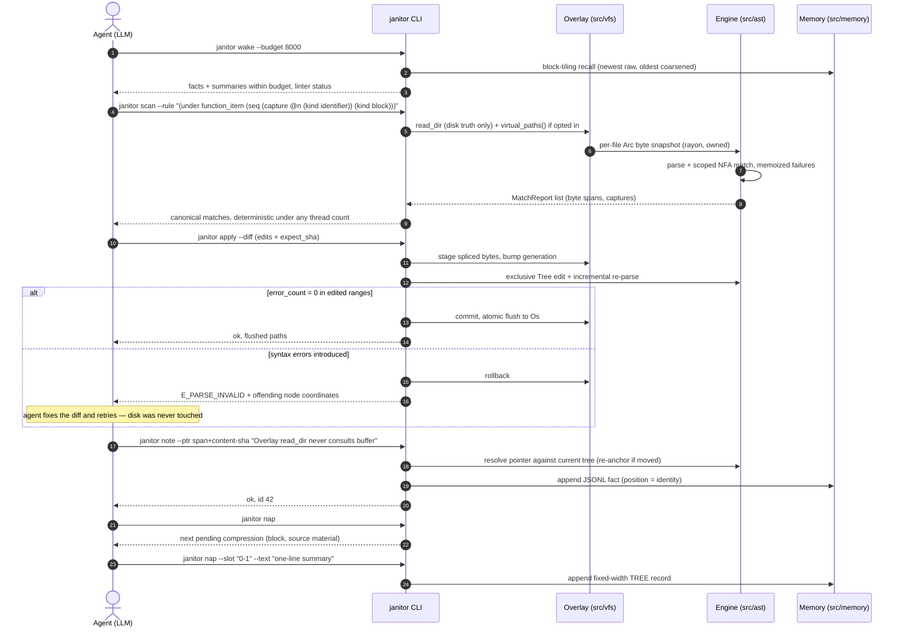
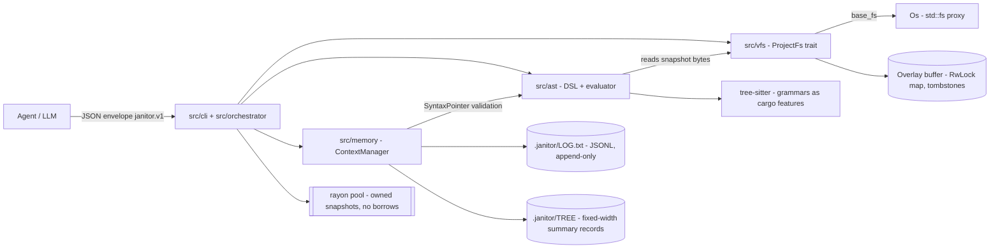
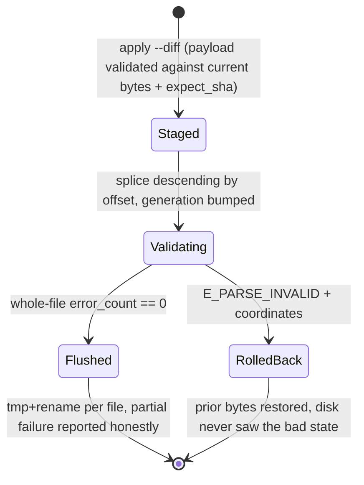

# janitor-prime

A single statically-linked Rust binary (`janitor`) that gives autonomous LLM
agents three fused capabilities over a target codebase:

1. **`src/vfs`** — a transactional virtual filesystem: an `Overlay` over `Os`
   that simulates edits in memory, with a strict anti-phantom invariant and
   commit/rollback boundaries around multi-file changes.
2. **`src/ast`** — a structural search/rewrite engine over
   [tree-sitter](https://tree-sitter.github.io/), driven by a small
   s-expression DSL with explicit scope semantics and a proven linearity
   bound.
3. **`src/memory`** — a persistent, append-only memory with anti-hallucination
   syntax pointers and a synchronous `nap` compression protocol. No LLM call
   ever happens inside the binary.

**Status:** pre-alpha. Phase F0 (scaffold + CI + grammar pin-check) and F1
(kill-point spikes: incremental re-parse, validity-gate honesty, trivia
semantics, parse throughput) are complete — measured outcomes in
[`docs/planning/PLAN.md`](docs/planning/PLAN.md) §5. The VFS module (F2) is
next. The `janitor --version` envelope below is the only implemented command
so far.

## Agent topology

`janitor` is designed as a **tool**, not a service: one process per
invocation, `stdin`/`stdout` only, zero network. The consuming agent drives
it as a state machine across a coding session — `wake → scan → apply → note`
— and compression is closed by the same agent via the synchronous `nap`
protocol.

### Session lifecycle



The two anti-hallucination gates are visible in the sequence: an agent
**cannot apply** a diff computed against a stale view (`expect_sha` mismatch
→ `E_STALE_VIEW`), and it **cannot note** a fact anchored to code that does
not exist (`SyntaxPointer` fails to resolve → `E_POINTER_DANGLING`).

### Module topology



Module dependency direction is acyclic and enforced:
`cli → orchestrator → {vfs, ast, memory}`, with `ast → vfs` (the parser reads
Overlay bytes, never disk) and `memory → ast` (pointer validation needs a
live tree). The `orchestrator::Session` is the only place the three domains
meet.

### The edit transaction



### The agent loop, in commands

| Step | Command | Consumer contract |
|---|---|---|
| Recall context | `janitor wake --budget N` | facts + summaries within a token budget; `E_NAP_PENDING` if a compression is owed first |
| Find refactor sites | `janitor scan --rule "..."` | canonical, thread-count-deterministic match coordinates |
| Stage + validate + flush | `janitor apply --diff '...'` | typed errors (`E_STALE_VIEW`, `E_EDIT_OVERLAP`, `E_PARSE_INVALID`) or flushed paths |
| Persist a fact | `janitor note --ptr ... "..."` | anchored note id, or `E_POINTER_DANGLING` |
| Compress | `janitor nap` / `nap --slot ... --text ...` | the agent writes the summary; the tool sequences and stores it |

## The stdout contract

`stdout` is 100% JSON, from day one. Every user-facing message flows through
a versioned envelope:

```json
{"schema":"janitor.v1","ok":true,"data":{"version":"0.1.0","grammars":["rust"]}}
```

Failures use the same envelope with an `error` body carrying a stable `E_*`
code. Diagnostics go to `stderr` via `tracing` (env-gated, `RUST_LOG`).
Exit codes: `0` success, `1` operational error, `2` usage error.

## Building

```sh
cargo build                  # default: rust grammar only (ADR-0015)
cargo build --features lang-all
cargo build --no-default-features
```

Language grammars are cargo features: `lang-rust` (default), `lang-python`,
`lang-go`, `lang-javascript`, `lang-typescript`, `lang-java`, `lang-c`,
`lang-all`.

## License

Dual-licensed under [MIT](LICENSE-MIT) OR [Apache-2.0](LICENSE-APACHE).
Credits and provenance in [NOTICE](NOTICE) — the memory design is inspired by
Victor Taelin's OptMem (ideas and formats only; that project ships no
license, so no code is copied), and the staged-edit pipeline shape is
indebted to lucasew's refactree (MIT; repo deleted, archived at pkg.go.dev).
